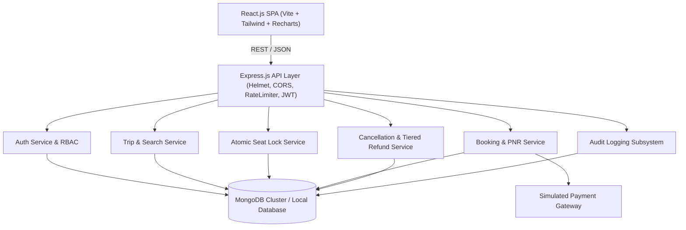

# ALGIONS BUS: Full-Stack Bus Booking Management System

[](https://nodejs.org/)
[](https://expressjs.com/)
[](https://www.mongodb.com/)
[](https://react.dev/)
[](https://tailwindcss.com/)
[]()

> A production-grade, database-driven **Bus Booking Management System** inspired by RedBus and modern movie-ticketing platforms. Built for the **ALGIONS AI LABS PRIVATE LIMITED** internship assessment.

---

## 📑 Table of Contents
1. [Core Features](#-core-features)
2. [Technology Stack](#-technology-stack)
3. [Architecture Overview](#-architecture-overview)
4. [Database & ER Diagram](#-database--er-diagram)
5. [Demo User Credentials](#-demo-user-credentials)
6. [Installation & Setup](#-installation--setup)
7. [Database Seeding](#-database-seeding)
8. [Automated Testing](#-automated-testing)
9. [API Documentation (Swagger)](#-api-documentation-swagger)
10. [Walkthrough Script](#-walkthrough-script)
11. [Assessment Verification Checklist](#-assessment-verification-checklist)

---

## 🚀 Core Features

### 1. Customer Experience (RedBus Inspired)
- **Dynamic Search Engine**: Load Indian States and Cities dynamically from MongoDB, with location swapping and date validation.
- **Interactive Movie-Hall Seat Booking**: Lower and Upper Deck layouts, driver position indicator, distinct sleeper and seater visual cards, seat status indicators (Available, Selected, Booked, Locked, Blocked).
- **Atomic Concurrency & Temporary Seat Locking**: Prevents race conditions and double bookings with 5-minute atomic locks and automatic rollback on conflicts.
- **Server-Side Fare Calculation**: Automatic computation of base fare, 5% GST, and transparent discount breakdowns.
- **Simulated Payment Module**: Realistic sandbox simulating UPI (GPay, PhonePe), Credit/Debit Cards, Net Banking, and Wallets with configurable success and failure testing.
- **Unique PNR & PDF Ticket Generation**: Instant 10-character alphanumeric PNR generation with professional PDF ticket download (jsPDF) and browser print capabilities.
- **Customer Dashboard & Booking Management**: Real-time booking history with automated cancellation and tiered refund estimates.

### 2. Operator Portal
- **Fleet & Route Management**: Assigned buses, seat layouts, scheduled trips, and active routes.
- **Live Passenger Manifests**: Detailed passenger boarding rosters with instant seat occupancy reconciliation bars.
- **Operator-Specific Telemetry**: Filtered analytics isolating data strictly to the authenticated operator's fleet.

### 3. Enterprise Admin Command Center
- **Executive Analytics**: Recharts data visualizations showing 14-day booking volume, revenue metrics, booking status distribution, and fleet occupancy rates.
- **User & Operator Management**: One-click account activation, deactivation, and operator licensing approvals.
- **Customizable Cancellation Policies**: Configurable refund tiers ($>24\text{h}: 90\%$, $12-24\text{h}: 75\%$, $4-12\text{h}: 50\%$, $<4\text{h}: 0\%$).
- **Immutable Audit Trail**: Structured event logging recording user actions, IP addresses, resource IDs, and timestamps.

---

## 🛠 Technology Stack

- **Frontend**: React.js 18 + Vite, React Router DOM v7, Tailwind CSS, Axios, Lucide React, Recharts, jsPDF.
- **Backend**: Node.js + Express.js, MongoDB 8.x + Mongoose ODM, REST APIs, JWT, bcryptjs.
- **Security & Validation**: Helmet, CORS, Express-Rate-Limit, Zod schema validation.
- **Testing & Tooling**: Jest + Supertest (24 unit & integration tests), Swagger / OpenAPI 3.0.

---

## 🏛 Architecture Overview



Detailed technical documentation is available in [ARCHITECTURE.md](file:///c:/Users/dell/OneDrive/Desktop/BusBookingPlateform/docs/ARCHITECTURE.md).

---

## 📊 Database & ER Diagram

The platform utilizes 18 distinct Mongoose models:
`User`, `Operator`, `State`, `City`, `Bus`, `Route`, `Stop`, `Trip`, `TripSeat`, `SeatLock`, `Booking`, `Passenger`, `Payment`, `Cancellation`, `Refund`, `Review`, `CancellationPolicy`, `AuditLog`.

See the complete diagram and index definitions in [ER_DIAGRAM.md](file:///c:/Users/dell/OneDrive/Desktop/BusBookingPlateform/docs/ER_DIAGRAM.md).

---

## 🔑 Demo User Credentials

The database seeder pre-populates three verified roles. These can be selected with **1-click Quick Login** on the login page:

| Role | Email Address | Password | Permissions |
| :--- | :--- | :--- | :--- |
| **Admin** | `admin@algionsbus.com` | `Admin@123` | Full system control, charts, user/operator toggles, audit logs. |
| **Operator** | `operator@zingbus.com` | `Operator@123` | Assigned buses, scheduled trips, live passenger manifests. |
| **Customer** | `customer@gmail.com` | `Customer@123` | Search, seat booking, ticket download, cancellations & refunds. |

---

## 💻 Installation & Setup

### Prerequisites
- Node.js v18+ (tested on v22.13.1)
- npm v10+
- MongoDB v6.0+ running on `127.0.0.1:27017`

### 1. Clone & Install Dependencies
From the repository root:
```bash
# Installs both backend and frontend dependencies in one step
npm install
```

### 2. Environment Configuration
The backend comes pre-configured with `backend/.env.example`. Create `backend/.env`:
```env
PORT=5000
MONGODB_URI=mongodb://127.0.0.1:27017/bus_booking_db
JWT_SECRET=super_secret_jwt_key_bus_booking_platform_2026_algions
JWT_EXPIRES_IN=7d
NODE_ENV=development
CORS_ORIGIN=http://localhost:5173
SEAT_LOCK_DURATION_MINUTES=5
MAX_SEATS_PER_BOOKING=6
```

---

## 🗄 Database Seeding

Run the dynamic, idempotent database seeder:
```bash
npm run backend:seed
```

This populates MongoDB with:
- **20 Indian States** (Maharashtra, Karnataka, Delhi, Tamil Nadu, etc.)
- **55 Major Cities** with codes and state mappings
- **100+ Boarding and Dropping Stops** with landmarks
- **30 Bus Operators** (Zingbus, IntrCity, VRL Travels, SRS, etc.)
- **50 Buses** with realistic models (Volvo 9600, Scania, BharatBenz) and layouts (Sleeper 2+1, Seater 2+2, Mixed)
- **50 Intercity Routes** (Delhi-Chandigarh, Mumbai-Pune, Bengaluru-Chennai, etc.)
- **112 Scheduled Trips** across dynamic dates relative to execution
- **3,624 Atomic TripSeats**
- Sample confirmed and cancelled bookings, payments, and audit logs.

---

## 🧪 Automated Testing

Execute the automated test suite with Jest and Supertest:
```bash
npm run backend:test
```

### Test Coverage Highlights (24 Passing Tests)
- **Auth & RBAC**: Positive registration, duplicate email handling (409 Conflict), login validation, JWT verification, customer RBAC denial from admin endpoints.
- **Location & Search**: Dynamic states/cities lookup from MongoDB, origin-to-destination search, AC/Sleeper filters.
- **Seat Concurrency & Booking**: Seat layout retrieval, atomic 5-minute locking, double-locking rejection (409 Conflict), passenger validation, unique PNR generation, idempotency replay prevention, PDF ticket generation.
- **Cancellation & Manifests**: Pre-flight tiered refund estimation, cancellation processing, seat inventory release verification, operator manifest passenger reconciliation.

---

## 📖 API Documentation (Swagger)

Start the backend server and navigate to:
```text
http://localhost:5000/api/docs
```
Raw OpenAPI 3.0 JSON specification is available at `http://localhost:5000/api/docs.json`.

---

## 🎬 Running the Application Locally

Run backend and frontend concurrently:

### Terminal 1: Backend Server
```bash
npm run backend:dev
# Running on http://localhost:5000
```

### Terminal 2: Frontend Client
```bash
npm run frontend:dev
# Running on http://localhost:5173
```

---

## 📋 Walkthrough Script

A complete 3-5 minute demonstration guide for the assessment evaluator is available in [WALKTHROUGH_SCRIPT.md](file:///c:/Users/dell/OneDrive/Desktop/BusBookingPlateform/docs/WALKTHROUGH_SCRIPT.md).

---

## ✅ Assessment Verification Checklist

- [x] Three server-side RBAC roles implemented (Customer, Operator, Admin).
- [x] Search form queries real MongoDB data (States, Cities, Routes).
- [x] Movie-hall style interactive seat layout with Lower/Upper decks, Sleeper/Seater styles, and Driver position.
- [x] 5-Minute atomic temporary seat locking preventing double booking.
- [x] Server-side fare calculation and simulated payment module.
- [x] Unique alphanumeric PNR generation and official PDF ticket download.
- [x] Configurable tiered cancellation policies with server-side refund calculations.
- [x] Operator passenger manifests with seat occupancy reconciliation.
- [x] Admin dashboard with Recharts visualizations and audit logs.
- [x] Comprehensive idempotent seed script (20 states, 55 cities, 30 operators, 50 buses, 50 routes, 112 trips).
- [x] 24 Automated tests passing with 100% success rate.
- [x] Complete documentation: ER diagram, Architecture diagram, Swagger, Walkthrough script, and Technical Report.
