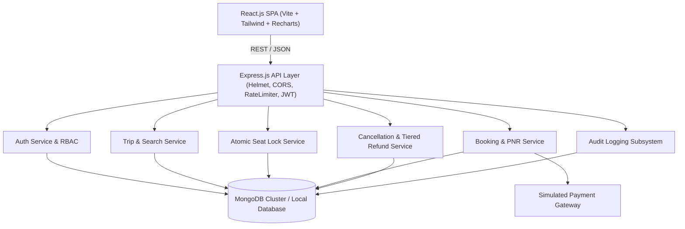
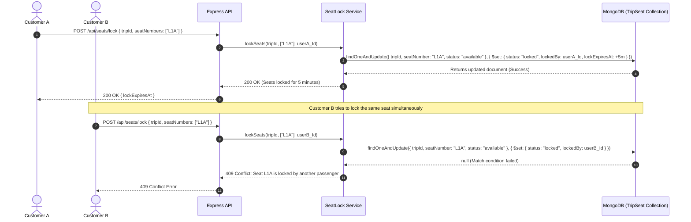
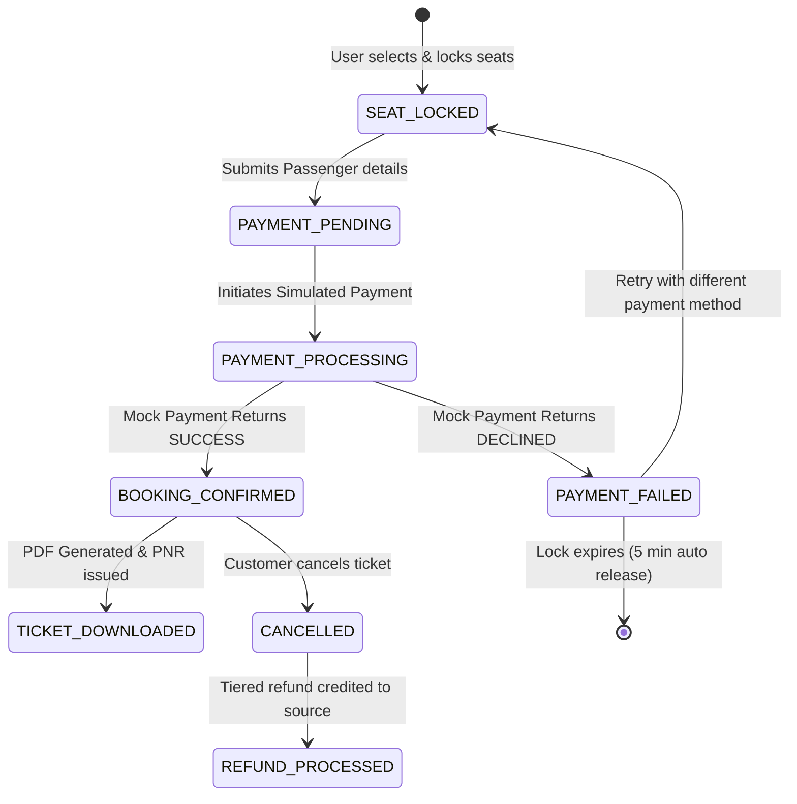

# System Architecture & Technical Specifications

## 1. High-Level Architecture Overview

The **Bus Booking Management System** uses a decoupled client-server architecture with an Express.js REST API and a React 18 single-page application.

---

## 2. Concurrency Control & Atomic Seat Locking Sequence

When multiple users attempt to select and book the same seat simultaneously, concurrency is managed using conditional atomic queries:

---

## 3. Booking Confirmation & Payment State Flow

---

## 4. Tiered Cancellation & Refund Engine

Refund calculation happens strictly server-side relative to current timestamp and departure date:

$$ \Delta T = T_{\text{departure}} - T_{\text{now}} $$

| Time Remaining ($\Delta T$) | Refund % | Cancellation Fee % | Action |
| :--- | :--- | :--- | :--- |
| $> 24\text{ hours}$ | **90%** | 10% | Instant Simulated Refund + Seat Inventory Restored |
| $12 - 24\text{ hours}$ | **75%** | 25% | Instant Simulated Refund + Seat Inventory Restored |
| $4 - 12\text{ hours}$ | **50%** | 50% | Instant Simulated Refund + Seat Inventory Restored |
| $< 4\text{ hours}$ | **0%** | 100% | No Refund + Seat Inventory Restored |
