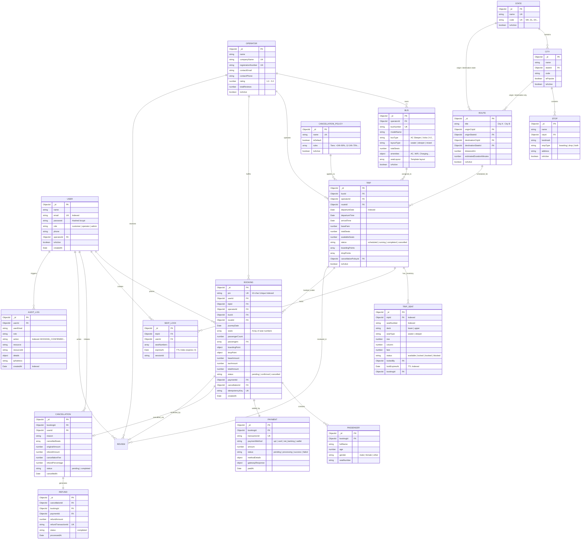

# Entity-Relationship (ER) Diagram & Database Architecture

## Overview
The **Bus Booking Management System** is built on MongoDB using Mongoose ODM with strict schema validation, referential integrity, and compound unique constraints to guarantee ACID guarantees for concurrent seat reservations.

---

## Mermaid Entity-Relationship Diagram



---

## Compound Indexes & Concurrency Safeguards

1. **TripSeat Double-Booking Prevention**:
   ```javascript
   tripSeatSchema.index({ tripId: 1, seatNumber: 1 }, { unique: true });
   ```
   *Guarantees at the database engine level that no two records can exist for the same seat on any given trip.*

2. **Seat Lock Expiration**:
   ```javascript
   tripSeatSchema.index({ status: 1, lockExpiresAt: 1 });
   seatLockSchema.index({ expiresAt: 1 }, { expireAfterSeconds: 0 });
   ```
   *Powers ultra-fast index queries for expired locks and auto-eviction.*

3. **Trip Search Performance**:
   ```javascript
   tripSchema.index({ routeId: 1, departureDate: 1, status: 1 });
   tripSchema.index({ operatorId: 1, departureDate: 1 });
   ```
   *Ensures zero full-collection scans even with hundreds of thousands of daily scheduled trips.*

4. **Booking Lookup & Idempotency**:
   ```javascript
   bookingSchema.index({ pnr: 1 }, { unique: true });
   bookingSchema.index({ idempotencyKey: 1 }, { unique: true, sparse: true });
   bookingSchema.index({ userId: 1, createdAt: -1 });
   ```
